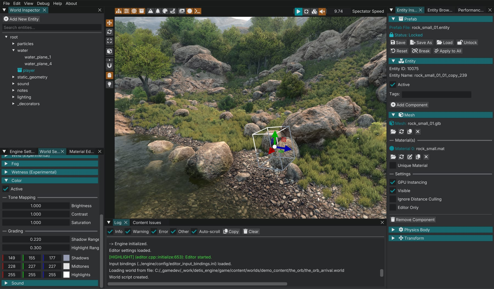

# Detis Engine

Detis (from the Greek Δέτης, meaning "the one who binds together") is a game engine for solo devs and small indie teams making single-player, 3D, desktop games. 

This documentation is designed to get you up and running with the Detis toolset.

For platforms or hardware support, units, or terminology, see [Engine reference](engine_reference.md).

## Continue reading

**Next:** [FAQ](faq.md): what Detis is (and is not) before you install.
