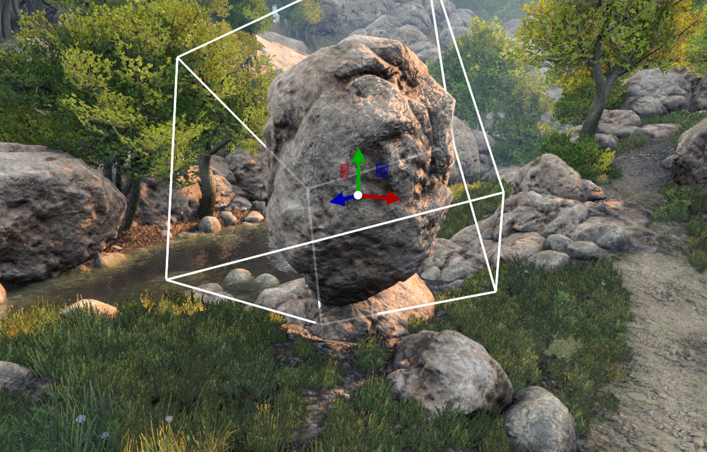

# Quick start

## 1. Run your copy

Open `bin/` at your project root and run `detis_engine`.

**This copy is already your game.** You do not create a project elsewhere.

The app starts in the **editor**. Editor and game are the same executable. 

1. Press **`Ctrl+P`** or **`Alt+P`** (or the **Play** button) to enter **game** mode.
2. Press `Ctrl+P` / `Alt+P` again or Escape to return to the **editor**.

## 2. Edit, save, undo

Back in the editor:

1. Click something in the viewport (a rock or similar prop).
2. Move it with the **translate** arrows on the object (press **`W`**, or click the move button on the left transform rail).
3. **File -> Save World** (`Ctrl+S`). 
4. Press `Ctrl+P` / `Alt+P` again to check the change in game mode.
5. Optional: To reverse the move, **Edit → Undo** (`Ctrl+Z`). Save again if you want that undo written to disk.

Redo is `Ctrl+Y` or `Ctrl+Shift+Z`.

## 3. Load a world in the editor

1. File -> Load World (`Ctrl+L`).
2. Open `worlds/demo_content/the_orb/the_orb_cave.world`.

## 4. Optional: open that demo on startup

1. **File → Project Settings**.
2. Set **Entry World** to `worlds/demo_content/the_orb/the_orb_cave.world` (or any `.world` you prefer).
3. Restart the executable. The entry world does not reload until the next launch.

> **Note:** The same value is stored in `content/config/default_game.ini` under `[Core]` as `default_world`. You can edit that file directly instead if you prefer.

## Continue reading

**Previous:** [Installation](installation.md): run your engine copy.

**Next:** [Project layout](project_layout.md): where your game files live on disk.
