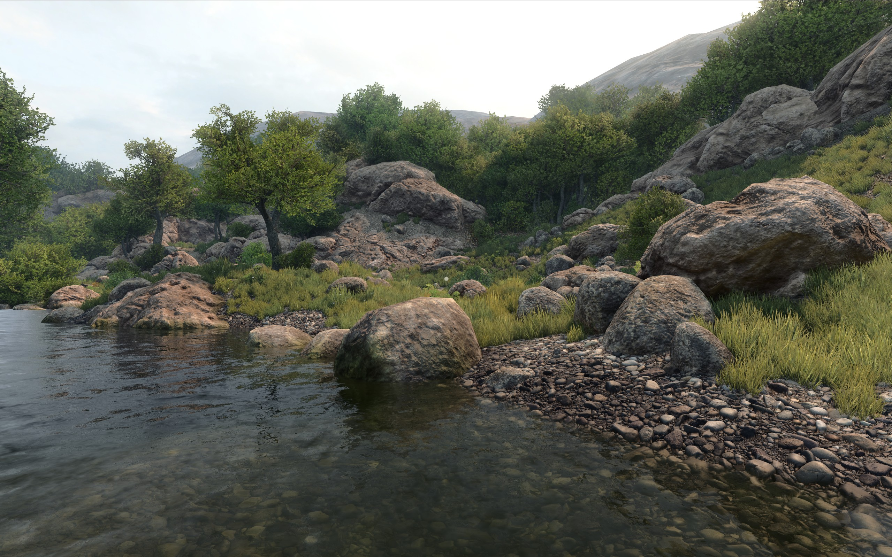

# Sample content

[The Orb](https://detissoftworks.itch.io/the-orb-detis-demo) demo data ship with the engine package so you can play with something on day one. You can ignore or delete all of it and replace it with your own work.

Shipped content is meant to be used inside Detis only. Use it in games you build with this engine, not as a general asset pack for other tools.

Other than that, any third party assets are **CC0**, meaning they are free to use in your games. There is a license file inside each of those third party folders. 

Feel free to move, modify, rewrite, or delete sample content as you build your game.

## Continue reading

**Previous:** [Project layout](project_layout.md): `bin`, `content`, and `engine`.

**Next:** [Your first world](/tutorials/your_first_world.md): build a small world (tutorial).
