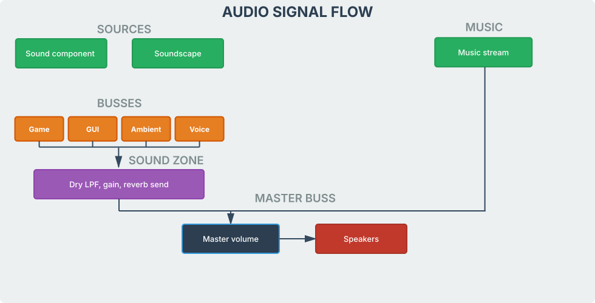

# Audio

Detis audio is built into the engine and supports all the essential concepts such as spatial SFX on entities, ambient soundscapes, listener-based **Sound Zones**, category mixing, and streamed music while remaining simple to use. You do not need to install any complex middleware stack on the side. 

## Categories (Busses)

Every in-game sound (except music which uses its own buss) uses one category. You pick it on the Sound component in the editor.

| Category | **Edit -> Engine Settings** slider | Use |
|----------|-----------------------------------|-----|
| **Game** | **Game** | Footsteps, impacts, interactions (gameplay SFX bus). |
| **GUI** | **UI** | Menus and HUD. Cannot join Sound Zones. |
| **Ambient** | **Ambient** | Soundscapes and environment beds. |
| **Voice** | **Voice** | Dialogue. |

**Music** uses the separate **Music** slider (not a Sound category). **Master** caps everything after those sliders.

Think of a category as **which group owns this sound**. Assign footsteps to **Game** and they ride the **Game** slider with every other Game sound. Turn that slider down and the whole group goes down together. Open **Edit -> Engine Settings** and use the **Sound** block for levels. The **Reverb** checkbox there enables the shared effect engine-wide. Per-room wet level still comes from **Sound Zone** entities and world **Default Sound Zone**. Inside Sound Zones, the category also picks which **reverb send** row applies (Game vs Ambient vs Voice).

## Pause behavior

When the player pauses the game, the **same category groups** decide what pauses with the world and what keeps playing.

- **Game**, **Ambient**, and **Voice** Sound components pause. They resume when the game unpauses.
- **Soundscape** beds (loops and one-shots) pause with the world as well.
- **GUI** does not pause with the game.
- **Music** does not pause with the game. Use the music API if a pause menu should silence the track.

## Signal flow

## Continue reading

**Previous:** [Detis Engine Manual](index.md): manual home.

**Next:** [Sound component](audio_sound_component.md): add a Sound component and play from Lua.
