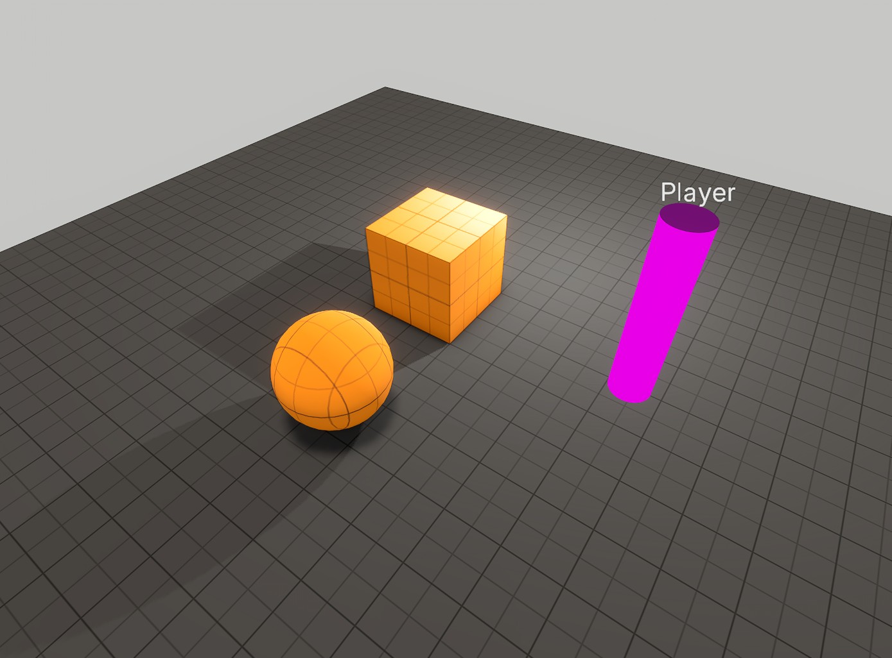
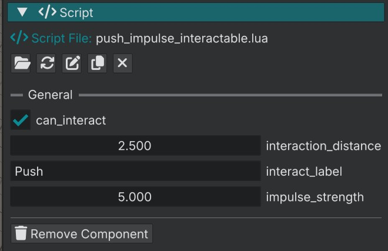

# Kick the ball

Let's take the sphere from [Your first prefab](your_first_prefab.md), and make it a **Dynamic**.

## 1. Give the ball room and a clear backdrop

1. Select `ground` in the World Inspector.
2. Open **Transform** and set Scale to `100`, `0`, `100`.

That gives you a wide floor to chase the ball.

## 2. Make the body Dynamic

The prefab tutorial left the sphere **Static** but we need a **Dynamic** body.

In the Entity Inspector Panel with the ball entity selected in the viewport:

1. Open the **Physics Body** section and set **Body Type** to **Dynamic**. This will make the ball react to physics. 
3. Open the **Transform** section and turn on **Enable Interpolation**. Physics steps on a fixed tick. Interpolation blends the rendered pose between those steps so rolling and kicks look smoother instead of stuttering.

Optional: enable **Debug Visualization** (or **Debug → Toggle Collision Debug**, `Shift+C`) to confirm the sphere shape still matches.

**File → Save World** (`Ctrl+S`), then hit **Play** (`Ctrl+P` / `Alt+P`). Walk into the ball. The demo player can still shove it with their body even before you add the script. Toggle back to the editor when you are done.

## 3. Add a Script component

1. With the sphere selected, click **Add Component**.
2. Choose **Script**.
3. Open the **Script** section in the Entity Inspector.
4. On **Script File**, browse to `scripts/components/push_impulse_interactable.lua`. Best to not edit this file if you plan to keep the demos as reference. 

## 4. Play and push (default strength)

1. **File → Save World** (`Ctrl+S`).
2. **Debug → Play Game** (`Ctrl+P` / `Alt+P`), or **Play** on the viewport toolbar.
3. Walk up to the sphere and look at it.
4. The HUD should show the interact label and your **Interact** key (whatever is bound).
5. Press Interact and see the ball launch.
6. Toggle back to the editor with `Ctrl+P` / `Alt+P`.

## 5. Script parameters

Scripts can expose values to the Entity Inspector so you can tweak them without editing Lua every time. This push script shows a few, including **impulse_strength** (default `40`).

Parameter widgets use the names from the `--@PARAMETER` lines in the script (`impulse_strength`, `interact_label`), not title case.

On a light Dynamic sphere, `40` is huge. The ball should launch like it exploded off the kick. 

1. Select the sphere.
2. In the **Entity Inspector**, open the **Script** section and set **impulse_strength** to `5`.
3. Play again and Interact once more.

Same script file, much calmer kick. That is the point of inspector parameters. Tune gaeplay feel without opening the `.lua` script files.

## Continue reading

**Previous:** [Your first prefab](your_first_prefab.md): components and Prefab Save.

**Next:** [Edit a script](edit_a_script.md): copy the interactable script to `kick_ball.lua`, edit, reload, hop, and bounce.
