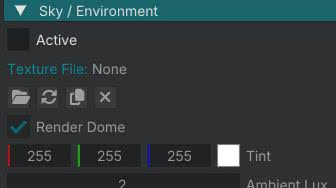

# World settings and sky

Keep your tutorial world open from [Edit a script](edit_a_script.md). You already know entity components and scripts. This step is about properties stored on the **`.world`** file.

## 1. Open World Settings

In the **Entity Inspector** we tweaked one entity at a time. **World Settings** edits the loaded world (sky, sun, fog, exposure, sound, and more).

Open **View -> World Settings** (`Shift+3`). Or the **globe** button on the viewport toolbar (tooltip **World Settings**).

At the top of the panel:

- **World Name** renames the world.
- **Script** holds World Script (optional `.lua` game logic for this world). For scripting depth, see [World scripts](../manuals/script_world.md).

Scroll down for collapsible categories. The editor lists them in this order:

- **Culling**
- **Sky / Environment**
- **Sunlight**
- **Screen Space AO**
- **Screen Space Bounce**
- **Reflections**
- **Exposure**
- **Bloom**
- **Wind (Experimental)**
- **Fog**
- **Wetness (Experimental)**
- **Color**
- **Sound**

For this tutorial we'll only need **Sky / Environment**. Every other category can stay at its defaults.

## 2. Sky / Environment

Expand **Sky / Environment**.

Two things control what you see:

- The sky panorama mesh draws only when **Active** and **Render Dome** are both on.
- With a **Texture File** loaded you see the texture. Without one you see a solid color set with **Tint**.

Try it: set **Active** to false. The visible sky dome turns off, useful when you want lighting without a backdrop, for example an indoor environment. Set it back to true when you're done.

## 3. Assign a sky `.dds` and IBL

1. Keep **Active** on.
2. On **Texture File**, use the **folder** icon (tooltip **Select file**) and pick a `.dds` texture file. Select `textures/demo_content/sky/sky_daylight_02.dds` from shipped demo content.
3. Under **IBL**, leave **Active** on for environment specular and diffuse (defaults `1.0` / `1.0`).

The engine loads the texture and rebakes sky IBL for reflections.

**IBL (Image Based Lighting)** means the sky itself becomes a light source. The engine rebakes the panorama into an environment probe and uses it for ambient light on shaded areas and for reflections on materials. Everything gets lit to match the backdrop, with no extra fill lights. 

## 4. Save and verify

1. **File -> Save World** (`Ctrl+S`).
2. Play (`Ctrl+P` / `Alt+P`).
3. Look at the backdrop and how materials catch reflections. If the panorama doesn't show, check **Render Dome**.

## Continue reading

**You have finished the guided tutorial path.** More tutorials are coming soon.

**Previous:** [Edit a script](edit_a_script.md): copy the interactable script, reload, hop, and bounce.

For scripting depth, see [Scripting overview](../manuals/script_overview.md), for sky texture details [Sky texture](../manuals/art_sky.md). Or use [Home](/README.md) and the sidebar for other topics.
