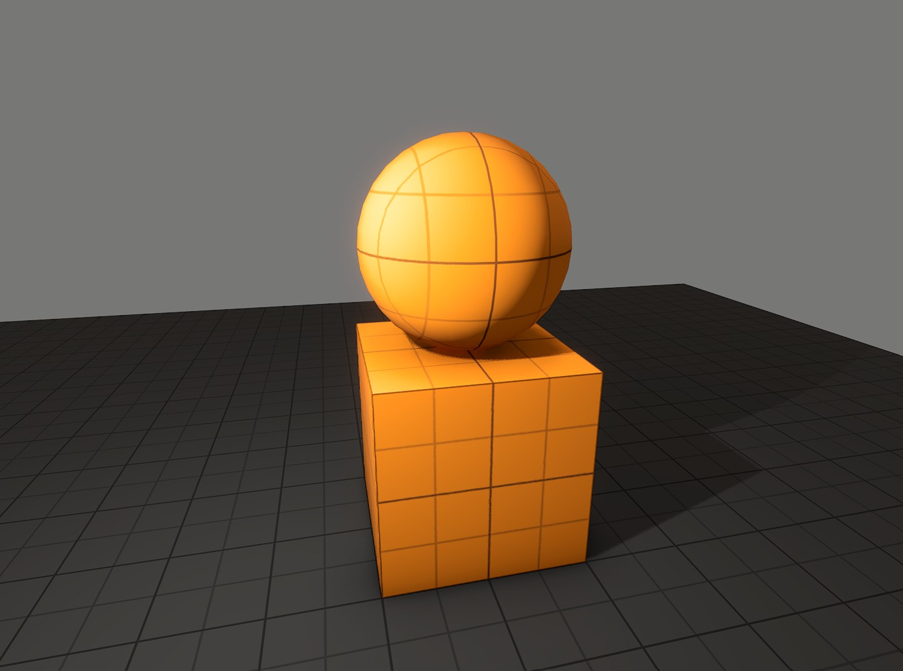
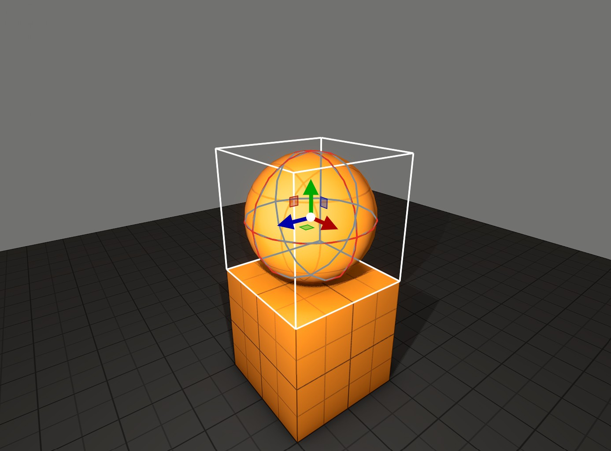

# Your first prefab

Let's build one entity from components, save it as a prefab, and load it back in the world.

The package already has `sphere.glb` under `meshes/primitive/`, but there is no matching `sphere.entity` yet. That is the gap we will fill.

You should already have a saved tutorial world open. If not, do [Your first world](your_first_world.md) first.

## What a prefab is

A prefab is an entity (and optionally its children in the world hierarchy) saved as *.entity file to disk to be reused. 

## 1. Add an empty entity

1. Open your tutorial world if it is not already loaded.
2. In the **World Inspector**, click **Add New Entity**.
3. The popup defaults to `new_entity`. Change it to `sphere` and confirm **Add**.

New entities come with a **Transform**. That is enough to start.

## 2. Add a Mesh component

1. Select `sphere` in the World Inspector.
2. In the **Entity Inspector**, click **Add Component**.
3. Choose **Mesh**.

## 3. Point the mesh at the sphere

1. Open the **Mesh** section.
2. On the mesh file field, browse to `meshes/primitive/sphere.glb`.
3. On **Material 0**, pick `materials/primitive/primitive_yellow.mat`.

You should see a sphere in the viewport. The mesh is about `1` unit across (radius `0.5`). Move it beside your cube with **Transform** or the translate gizmo (**W**), and set Position Y to `1.5` so it sits on the cube.

## 4. Add collision

1. With `sphere` still selected, click **Add Component** again.
2. Choose **PhysicsBody**.
3. Open the **Physics Body** section.
4. Leave **Body Type** on **Static** (the default).
5. Open **Shape 0** (a default box shape is already there).
6. Set **Type** to **Sphere**.
7. Set **Radius** to `0.5` so it matches the mesh.

## 5. Preview the collision shape

You want the wireframe sphere to line up with the mesh before you save the prefab.

**This entity only**

1. Still in **Physics Body**, enable **Debug Visualization**.
2. You should see this body's collision shape drawn in the viewport.
3. Toggle **Debug Visualization** off to hide it again. 

**Whole scene**

1. Make sure no entity is selected. 
2. Debug -> Toggle Collision Debug (`Shift+C`), or the collision button on the viewport toolbar.

Use whichever is handy. Per-entity debug is good while editing one shape. Scene-wide debug is good when you want to compare several bodies at once.
Use **Toggle Collision Debug** back to Off when you are done looking.

If the debug sphere does not match the mesh, fix **Radius** (and **Offset** if needed) before you save.

## 6. Save it as a prefab

1. With `sphere` still selected, open the **Prefab** section in the Entity Inspector.
2. Click **Save As**.
3. Browse to `entities/primitive/`.
4. Save as `sphere.entity`.

That file is now a reusable asset next to `cube.entity`, `plane.entity`, and the other primitives. Mesh, material, and collision travel with it.

## 7. Check it shows up in the Entity Browser

1. Open the **Entity Browser** (`Shift+Space`) if it is closed.
2. Click **Refresh** if `sphere.entity` is not listed yet.
3. Search `sphere`, then drag `sphere.entity` into the viewport.
4. Move the new instance so it is not sitting on top of the first one.

You now have two spheres spawned from one prefab file. Each instance in the world is its own copy. 

**Editing one sphere (radius, material, position) does not change the other.**

Prefabs do not auto-update. Resaving the linked `.entity` file does **not** refresh instances already in the map. That is true whether you use **Save** in the **Prefab** section, edit the file outside the editor, or change the asset and save again. Existing instances keep what they had until you choose an action:

- **Reset** on one instance reloads that instance from the file on disk.
- **Apply to All** reloads every instance in the currently open world that shares that prefab path.
- Dragging from the Entity Browser again spawns a **new** instance from the file as it is on disk now.

Lock, Unlock, Reset, Break, and Apply to All will be covered in a later guide. For now, **Save As** plus drag from the Entity Browser is enough.

## 8. Save the world

**File -> Save World** (`Ctrl+S`) so the new entities stay in your map.

## 9. Play and check collision

1. Hit the play button (or `Ctrl+P` / `Alt+P`) on the viewport toolbar.
2. Walk into a sphere with the demo player. It should block you like a solid prop.

Toggle back to the editor with `Ctrl+P` / `Alt+P` when you are done.

## Continue reading

**Previous:** [Your first world](your_first_world.md): save a small `.world`.

**Next:** [Kick the ball](kick_the_ball.md): script, interact, and reload Lua.
