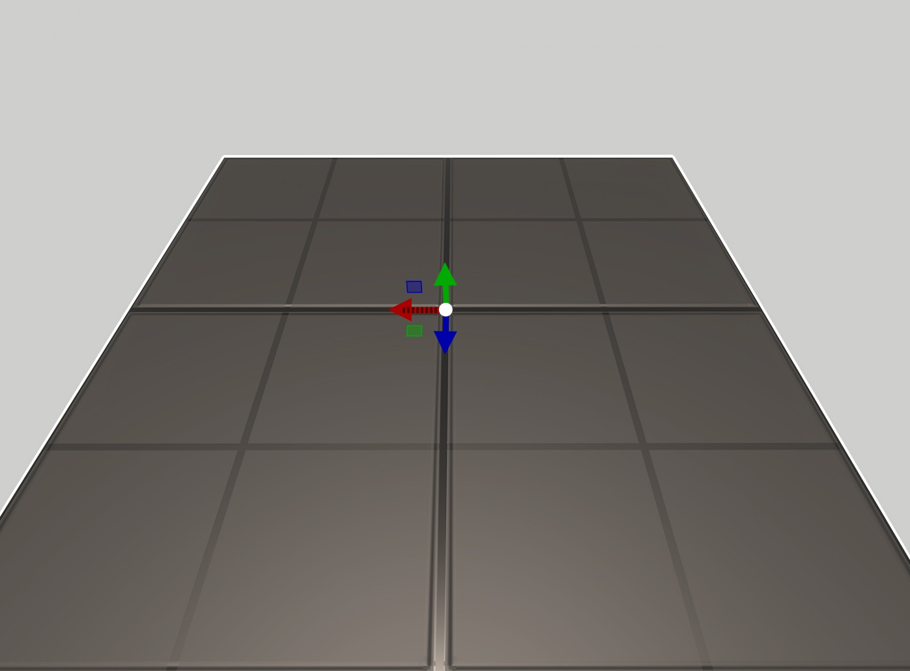
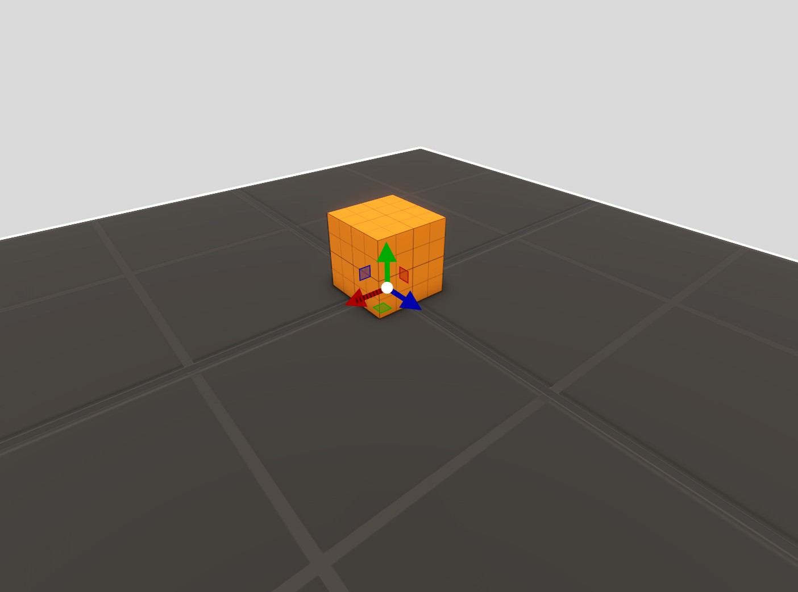
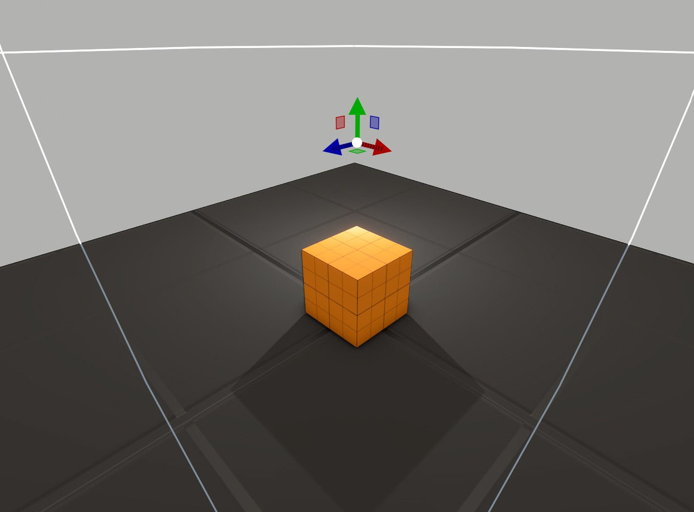
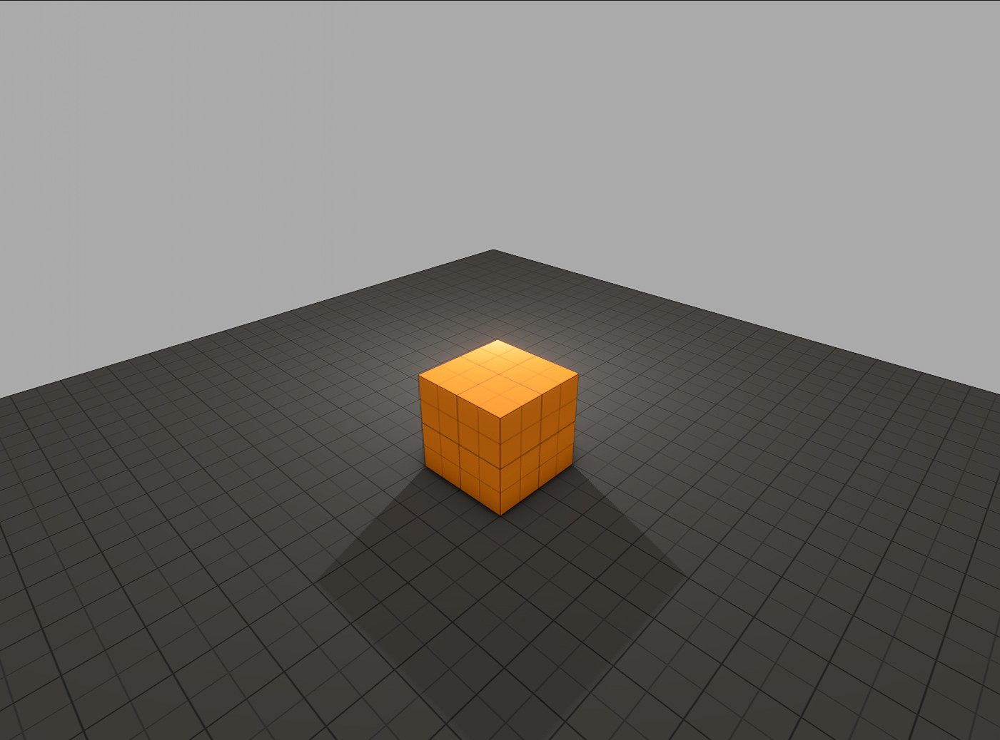
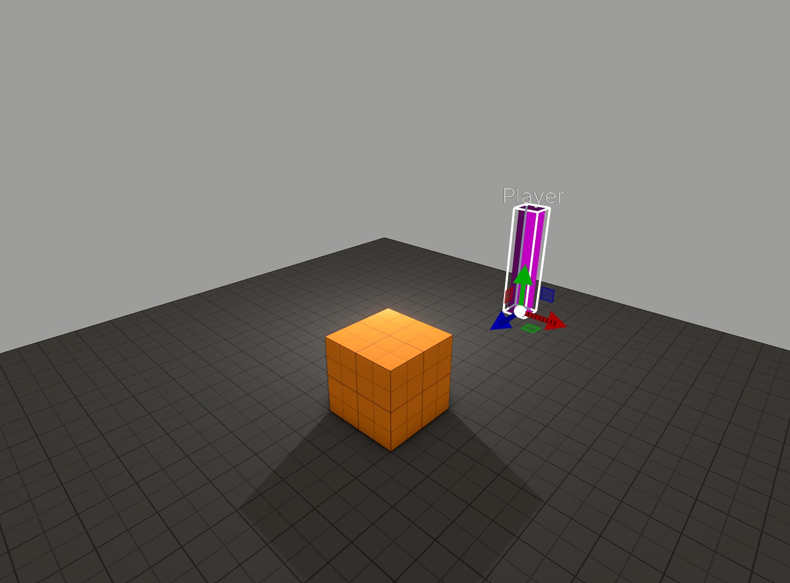

# Your first world

Build a small playable room from scratch: ground, light, a prop, materials, IBL, and the demo player.

## 1. New world

1. File → New World (`Ctrl+N`).
2. File → Save World As... (`Ctrl+Shift+S`).
3. Give it any name you like.

## 2. Required Tool Panels

1. View -> World Inspector (`Shift+1`) if it is not already open. You rename and parent entities here. 
2. View -> Entity Inspector (`Shift+2`) if it is not already open. You can add, edit, or remove components here.  
3. View -> Entity Browser (`Shift+Space`), or the archive-box button on the viewport toolbar. A list of prefabs ready to use. 

You can also use the viewport shortcuts to open and close these windows. 

## 3. Add a ground plane

1. In the Entity Browser, search `plane` (or open `content/entities/primitive/`).
2. Drag `plane.entity` into the viewport. Press F to focus on it if not visible. 
3. In the World Inspector, right-click it and select **Rename Entity** and name it `ground`.
4. Open **Transform** in the Entity Inspector and set:
   - Position: `0`, `0`, `0`
   - Rotation: `0`, `0`, `0`
   - Scale: `10`, `1`, `10`

   That makes the plane large enough for this tutorial.

   

## 4. Add a cube

1. Search `cube` in the Entity Browser.
2. Drag `cube.entity` into the viewport..
3. Open **Transform** and set Position to `0`, `0.5`, `0` so the cube sits on the plane.

## 5. Add a light

Add a point light.

1. In the Entity Browser, search `light_point`.
2. Drag `light_point.entity` into the viewport.
3. Open **Transform** and place it above the ground, for example:
   - Position: `1.0`, `2.5`, `1.0`
4. In the Entity Inspector, open the **Light** section.
5. Enable **Cast Shadows**.

The cube should cast a clear shadow across the ground. Prefab defaults (**Lumens** 800, **Range (m)** 30) are enough for this space. If there is no shadow, Edit -> Engine Settings -> Local Light Shadows must be on.

> **Note:** Local light shadows are expensive, especially for point lights. Be mindful when enabling them and reserve them only for hero lights. 

## 6. Apply materials

Materials live on the **Mesh** component. Each mesh slot has a **Material 0** (and more if the mesh has several slots).

1. Select `ground` in the World Inspector.
2. In the Entity Inspector, open the **Mesh** section.
3. On **Material 0**, browse and pick `materials/primitive/primitive_triplanar_dark_grey.mat`.

## 7. Add the demo player prefab

1. In the Entity Browser, search `player_character`.
2. Drag `player_character.entity` into the viewport.
3. Move it onto the ground in front of the cube, for example Position `0.0`, `0.0`, `3.0`.

## 10. Save and play

1. **File -> Save World** (`Ctrl+S`).
2. Hit the Play button (or `Ctrl+P` / `Alt+P`) on the viewport toolbar.
3. Walk around with the demo player controls, then toggle back to the editor with `Ctrl+P` / `Alt+P`.

## Continue reading

**Previous:** [Sample content](/getting_started/sample_content.md): demo worlds and prefabs.

**Next:** [Your first prefab](your_first_prefab.md): build a sphere prefab from components.
